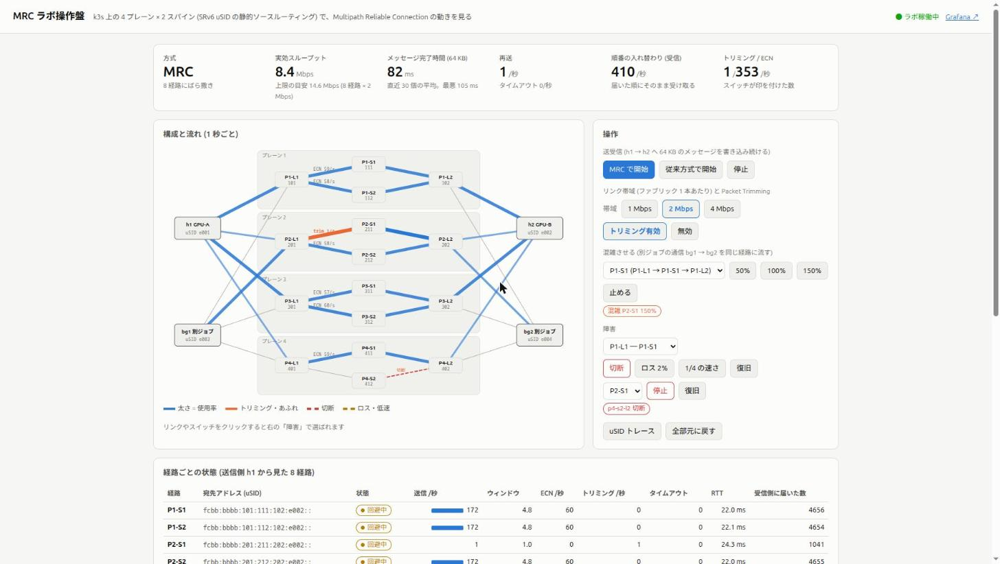

# k3s-mrc-lab — k3s で MRC (Multipath Reliable Connection) の動きを見るラボ

OpenAI などが 2026 年に発表した MRC の考え方 (マルチプレーン・パケットスプレー・SACK・Packet Trimming・
ECN による経路の回避・SRv6 uSID による静的ソースルーティング) を、k3s の 1 Pod の中に作った小さなファブリックで動かし、
操作盤のボタンで混雑や障害を起こして挙動を見るためのラボ。比較用に「従来方式 (1 フロー 1 経路 + go-back-N)」も入っている。



## 何が本物で、何が模擬か

| 部分 | 実装 |
|---|---|
| ファブリック | Linux のネットワークネームスペース 20 個 (GPU 役のホスト 2・別ジョブのホスト 2・スイッチ 16) と veth 32 本 |
| SRv6 uSID | **本物**。Linux カーネルの `seg6local action End flavors next-csid` で各スイッチが 16 bit ずつ shift する。スイッチの経路は全部静的 (BGP なし) |
| スイッチのキュー・ECN・Packet Trimming・障害 | eBPF (tcx egress) + fq qdisc で模擬。帯域を EDT で絞り、キュー長に応じて CE を付ける / ペイロードを切り捨ててヘッダーだけ優先して送る / 捨てる |
| MRC の送受信 | Python で模擬 (`fabric/mrc.py`)。NIC ではなくユーザ空間。RDMA ではなく UDP 4791 に独自の 32 バイトヘッダー |
| 従来方式 | 同じく Python。ECMP のハッシュで決まる 1 経路、順番どおりでないと受け取らない go-back-N。ルーティングの収束は「3 秒進まなければ別経路にハッシュし直す」で模擬 |

速度はノート PC で動かすために小さくしてある (ファブリックのリンク 1 本 2 Mbps、ホスト向けはその 2 倍)。
MRC の仕様そのものの再現ではなく、論文に書かれている考え方を目で見るためのもの。

## 構成

```
    h1 (GPU-A, 送信)                                  h2 (GPU-B, 受信)
    bg1 (別ジョブ)        ┌─ PnS1 ─┐                     bg2 (別ジョブ)
       └─ 4 プレーン ─ PnL1 ┤        ├ PnL2 ─ 4 プレーン ─┘      n = 1〜4
                          └─ PnS2 ─┘
```

- プレーン (1〜4) ごとにリーフ 2 台 + スパイン 2 台。プレーン同士はつながっていない (MRC の「NIC を 8 本に分けて 8 枚のネットワークにつなぐ」の 4 枚版)
- h1 → h2 の経路は 4 プレーン × 2 スパイン = 8 本。経路は送信側が宛先アドレスで選ぶ

### uSID (block `fcbb:bbbb::/32`、uSID 16 bit)

| ノード | uSID |
|---|---|
| リーフ PnL1 / PnL2 | `n01` / `n02` |
| スパイン PnS1 / PnS2 | `n11` / `n12` |
| h1 / h2 / bg1 / bg2 | `e001` / `e002` / `e003` / `e004` |

h1 → h2 をプレーン 2・スパイン 1 で送るときの宛先は `fcbb:bbbb:201:211:202:e002::`。
スイッチは自分の uSID を見たら左にずらすだけ (操作盤の「uSID トレース」で実際のパケットを確認できる)。

```
P2-L1 で受信  fcbb:bbbb:201:211:202:e002::
P2-S1 で受信  fcbb:bbbb:211:202:e002::
P2-L2 で受信  fcbb:bbbb:202:e002::
h2 で受信     fcbb:bbbb:e002::
```

### スイッチのポート (eBPF)

| 項目 | 既定値 |
|---|---|
| 帯域 | ファブリック 2 Mbps、ホスト向け 4 Mbps (操作盤で 1/2/4 Mbps に変更可) |
| ECN (CE を付ける) | キュー 6 KB 超 |
| Packet Trimming | キュー 15 KB 超。MRC のデータパケットだけ、ヘッダー (Ethernet〜MRC ヘッダー 94 バイト) を残して切り、待たせずに送る |
| テールドロップ | キュー 30 KB 超 (トリミング対象外のパケット) |
| 障害 | 切断 (全部捨てる)・ロス (確率で捨てる)・1/4 の速さ。両方向にかける |

### MRC モードの送受信 (`fabric/mrc.py`)

- 64 KB のメッセージ (1000 バイト × 64 パケット) を書き込み続ける。パケットを 8 経路に 1 個ずつ順番にばら撒く
- 受信側は届いた順に受け取り (順番の入れ替わりは気にしない)、1 個ずつ ACK (SACK) を返す
- トリミングされたヘッダーが届いたら受信側は即 NACK → 送信側は別の経路で即再送し、その経路をしばらく避ける (続けば 50 ms → 1 秒まで倍々)
- ECN の印が返ってきたら、その経路のウィンドウだけ絞り、少しの間避ける
- ACK が返らない (タイムアウト) 経路は故障とみなして使用停止、0.3 秒ごとにプローブを送り、応答があれば使用再開
- UDP チェックサムは 0 (uSID の shift で宛先が変わるのと、トリミングで長さが変わるため)

## 使い方

前提:

- k3s (単一ノードで確認。Grafana の Ingress は k3s 標準の Traefik を使う)
- Linux カーネル 6.6 以上。tcx (eBPF) と SRv6 の next-csid、`sch_fq` を使う。このラボは 7.0 で確認
- fabric の Pod は privileged で動く (Pod の中でネットワークネームスペース・veth・eBPF を作る。ホストのネットワークには触らない)
- イメージは amd64 / arm64 を公開しているが、確認したのは amd64 だけ

### 入れる

```bash
kubectl apply -k 'https://github.com/sasakipochi/k3s-mrc-lab?ref=v0.1.0'
kubectl -n mrc-lab rollout status deploy/mrc-fabric
```

namespace `mrc-lab` に、ラボ本体 (`ghcr.io/sasakipochi/mrc-fabric`)・Prometheus・Grafana が入る。
ラボは Pod の起動時に組み上がる (数秒)。

```bash
kubectl -n mrc-lab port-forward svc/mrc-fabric 8089:8080   # 操作盤 → http://127.0.0.1:8089/
```

- Grafana: http://grafana.mrclab.localhost/ (匿名で閲覧可)。この方法で入れた場合、admin は Grafana の既定 (admin/admin、初回ログインで変更を求められる)。
  自分で決めるなら `kubectl -n mrc-lab create secret generic grafana-admin --from-literal=admin-user=admin --from-literal=admin-password=...`
  を作って `kubectl -n mrc-lab rollout restart deploy/grafana`
- 操作盤には認証が無いので Ingress には出さず、port-forward (127.0.0.1) だけで使う
- 片付け: `kubectl delete ns mrc-lab` (Pod を消せばネームスペース・veth・eBPF も消える)

### 手元でビルドして入れる (開発用)

docker と `localhost:5000` のレジストリが要る
(無ければ `docker run -d -p 127.0.0.1:5000:5000 --name local-registry registry:3`)。

```bash
make              # イメージのビルド・push、fabric と Prometheus/Grafana を導入 (Grafana の admin パスワードはランダムに生成)
make console-ui   # 操作盤 → http://127.0.0.1:8089/  (Pod が入れ替わっても張り直す。Ctrl-C で終了)
make status       # 状態をターミナルに表示
make grafana-password
python3 tools/smoke.py   # 操作盤の全操作を API で試す (console-ui か port-forward を動かした状態で)
make down         # namespace ごと削除
```

リリースは `k8s/fabric/fabric.yaml` のイメージのバージョンを上げて `v<バージョン>` のタグを push すると、
GitHub Actions がイメージを ghcr.io に公開する。

### 見どころ

1. 「MRC で開始」→ 8 経路にほぼ均等にばら撒かれる。受信側では順番の入れ替わりが大量に起きるが問題にならない
2. 「uSID トレース」→ スイッチを 1 台通るたびに宛先が 16 bit ずつ左にずれる
3. 経路を選んで「150%」で混雑させる → トリミング → NACK → 別経路で即再送。その経路は避けられ、他の経路の流量は変わらない
4. リンクを「切断」→ その経路だけ故障扱い、残りで走り続ける。「復旧」でプローブが通って使用再開。スイッチ側は何もしない
5. 「従来方式で開始」→ 1 経路ぶんの速度しか出ない。混雑や切断に当たると go-back-N、切断では 3 秒止まる
6. 「トリミング無効」で混雑させる → タイムアウト待ちの再送になり、混雑しただけの経路を故障と区別できない

参考の測定値 (既定設定、障害なし): MRC 約 10〜14 Mbps・メッセージ完了時間 約 70〜80 ms、従来方式 約 1.8 Mbps・約 300 ms。

## ファイル

```
fabric/bpf/port.bpf.c     スイッチのポート (帯域・ECN・トリミング・障害・カウンタ) の eBPF
fabric/topo.py            トポロジ定義と構築 (ネームスペース・veth・アドレス・uSID 経路・eBPF の取り付け)
fabric/mrc.py             送信・受信・別ジョブの通信 (MRC / 従来方式)
fabric/controller.py      起動時にラボを組み立て、操作盤・API・/metrics を出す
fabric/static/index.html  操作盤
fabric/Dockerfile         eBPF をコンパイルする段 + 実行イメージ
kustomization.yaml        kubectl apply -k で全部入れる入口
k8s/fabric/               Deployment (privileged) と Service (ClusterIP)
k8s/monitoring/           Prometheus・Grafana (ダッシュボードは tools/make_dashboard.py で生成)
scripts/status.sh         状態表示
tools/smoke.py            操作盤の全操作の確認
.github/workflows/        CI と、タグでイメージを公開するリリース
```

## 参考

- Resilient AI Supercomputer Networking using MRC and SRv6 (OpenAI ほか)
  https://cdn.openai.com/pdf/resilient-ai-supercomputer-networking-using-mrc-and-srv6.pdf
- Multipath Reliable Connection (MRC) Specification (OCP) https://www.opencompute.org/documents/ocp-mrc-1-0-pdf
- RFC 9800 (SRv6 の圧縮 SID, uSID)
- SRv6 uSID を SR Linux 2 台で確かめたラボ: https://github.com/sasakipochi/k3s-srv6-usid-lab

## ライセンス

MIT
